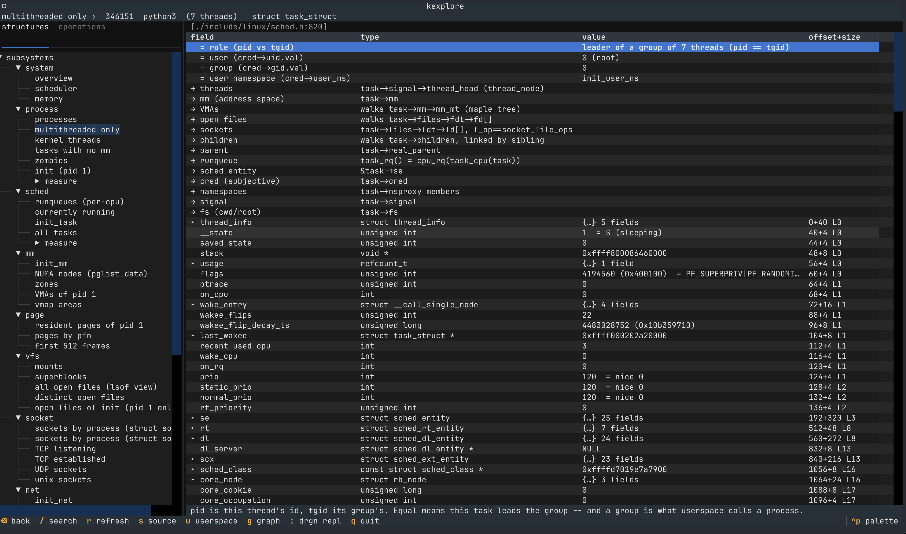
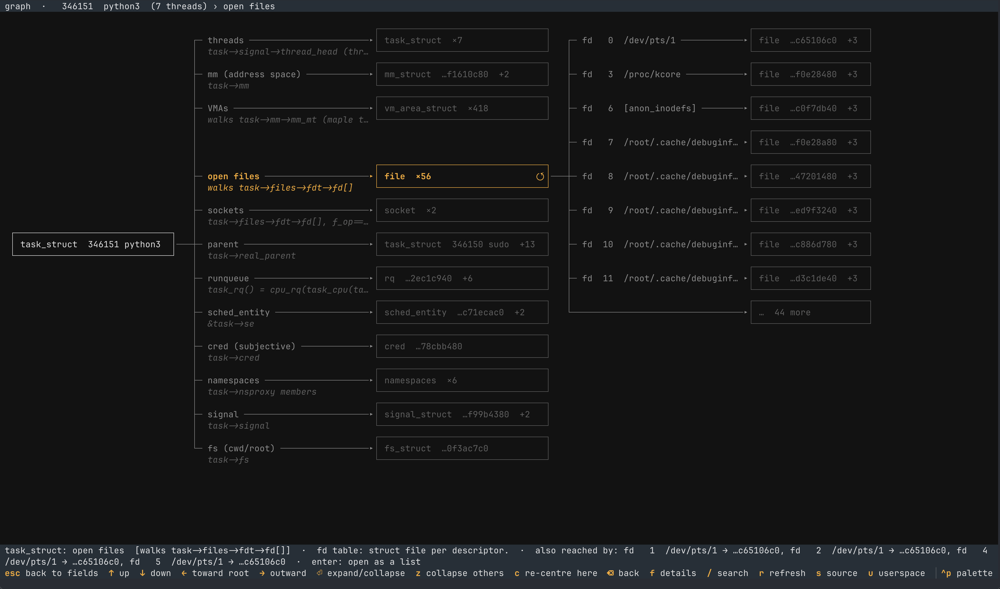
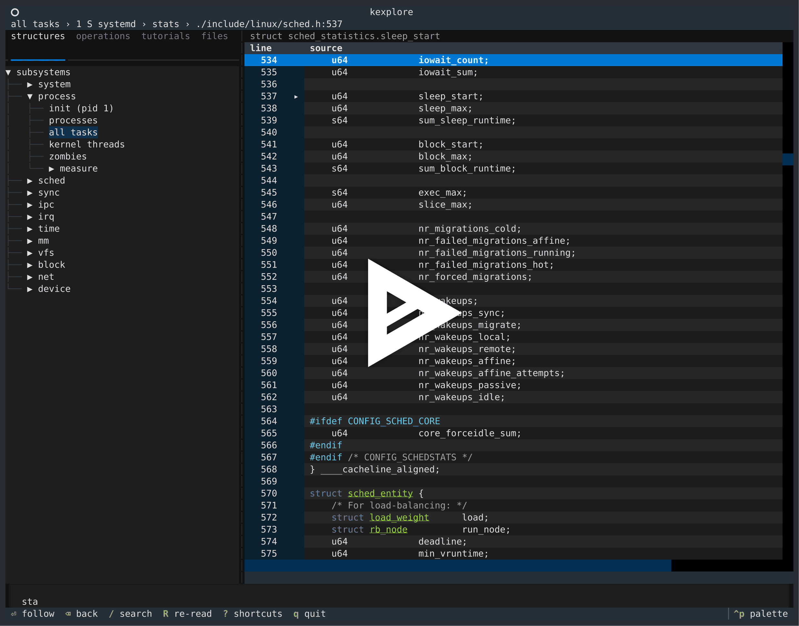
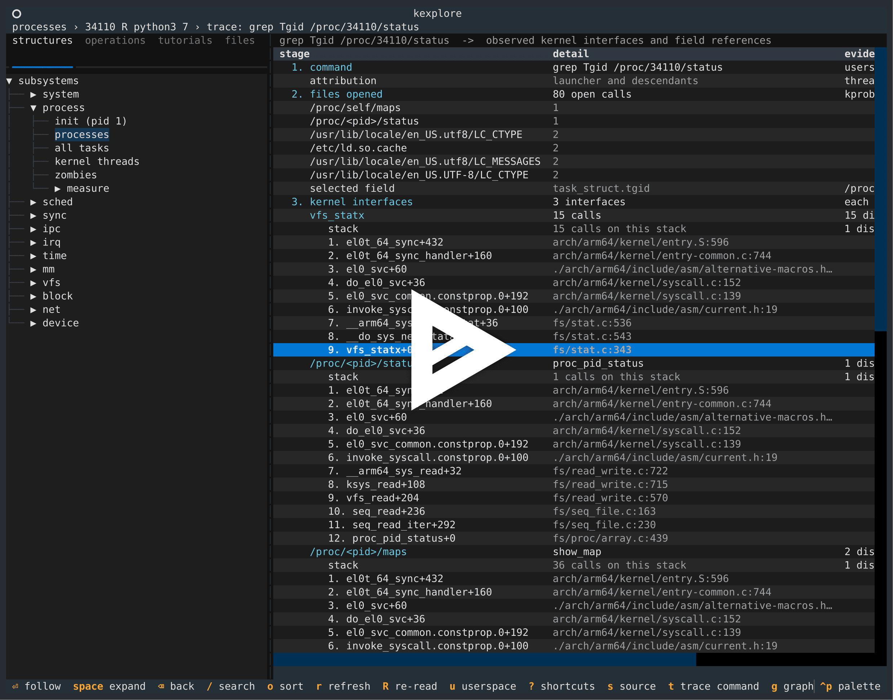

# kexplore

A terminal UI for exploring the data structures of a running Linux kernel:
open a struct, see its members' live values and layout, and follow its pointers
to the structures they reference. It attaches to the kernel with
[drgn](https://drgn.readthedocs.io/) through `/proc/kcore` and resolves types
from the kernel's DWARF debug info.

kexplore runs as root and reads kernel memory: use a VM or a lab machine, not a
production server. On macOS, `./setup.sh` creates a Fedora VM with lima and
kexplore reads that VM's kernel.

## Screenshots

| Struct browser | Object graph |
| --- | --- |
| <a href="docs/images/structure-browser.png"></a> | <a href="docs/images/task-graph.png"></a> |

## Recordings

| Overview | Userspace commands |
| --- | --- |
| <a href="https://asciinema.org/a/7FUWi1A86IITEUsq"></a> | <a href="https://asciinema.org/a/VcqzptRQikJhXV10"></a> |

Click a screenshot to open it at full size, a recording to play it on asciinema.org.

## Views

- **structures**: subsystems and their structs. `→` links reach related
  objects that are not members, such as a task's threads.
- **files**: `/proc` files line by line, each line annotated with the struct
  member it is read from; `j` opens that struct.
- **operations** (work in progress): kernel paths (task wakeup, page fault) as
  steps, each a function at `file:line`.
- **tutorials** (work in progress): guided sequences over processes and
  mappings on this machine.

## Getting started

```sh
./setup.sh        # prepare the lima VM, container or host, and check the tools
./run.sh --check  # resolve every catalog entry against this kernel, no UI
./run.sh          # start the explorer
```

- [docs/installation.md](docs/installation.md): requirements, backends, and what
  `setup.sh` changes on the host or virtual machine.
- [docs/](docs/README.md): how `kexplore` works, the kernel concepts and
  tutorials it covers, and development notes.
